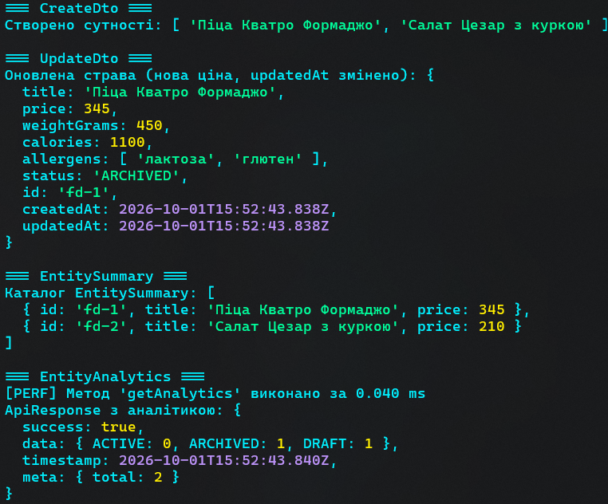

# PR4 WEB

Цей проєкт демонструє використання TypeScript для побудови типізованої архітектури репозиторіїв та Data Transfer Objects (DTO) на прикладі системи управління рестораном і доставкою їжі.

## Структура проєкту

- **`src/types/`**: Містить базові інтерфейси (`BaseEntity`), переліки статусу (`EntityStatus`), узагальнені типи відповідей API (`ApiResponse`), DTO (`CreateDto`, `UpdateDto`), та інші.
- **`src/decorators/`**: Демонстрація метапрограмування в TypeScript, включає декоратор `MeasureTime` для вимірювання часу виконання методу та `ImmutableClass` для заморожування класів.
- **`src/repositories/`**: Реалізація узагальненого in-memory репозиторію (`InMemoryRepository`) та спеціалізованого репозиторію страв (`FoodRepository`), які працюють з інтерфейсом `IRepository`.
- **`src/index.ts`**: Головний файл, де продемонстрована робота всіх компонентів: створення страв, їх оновлення, використання полегшених проєкцій та отримання аналітики.

## Інструкція для запуску

1. **Клонуйте репозиторій або розпакуйте архів проєкту:**
   Перейдіть до папки з проєктом:
   ```bash
   cd e:\project\WEB\PR3_WEB4
   ```

2. **Встановіть залежності:**
   Виконайте наступну команду для встановлення необхідних пакетів (`typescript`, `tsx`, `@types/node`):
   ```bash
   npm install
   ```

3. **Запустіть проєкт:**
   Для безпосереднього виконання TypeScript-файлу без попередньої компіляції використовуйте інструмент `tsx` (встановлений локально в dev-залежностях):
   ```bash
   npx tsx src/index.ts
   ```

## Демонстрація роботи (Скриншоти)




